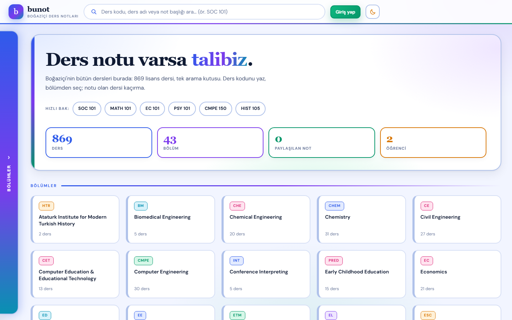
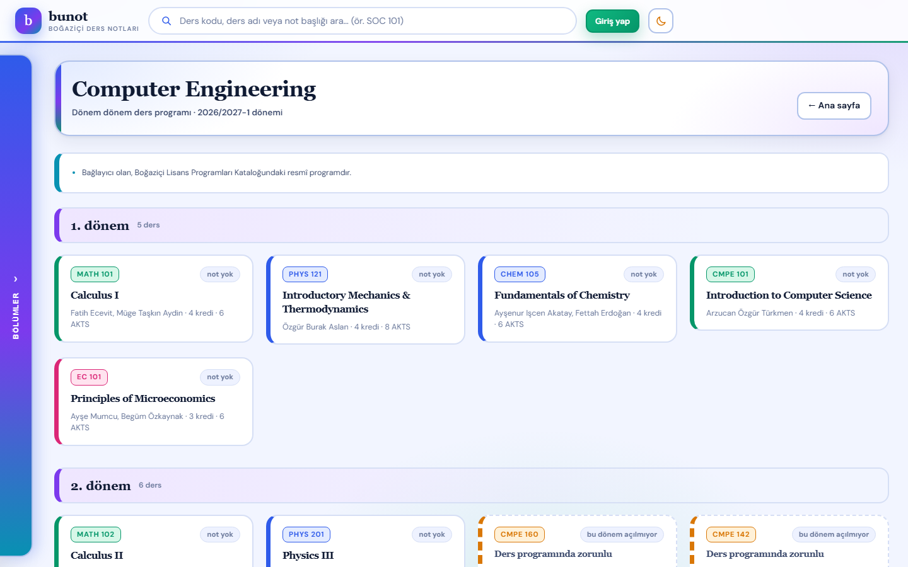
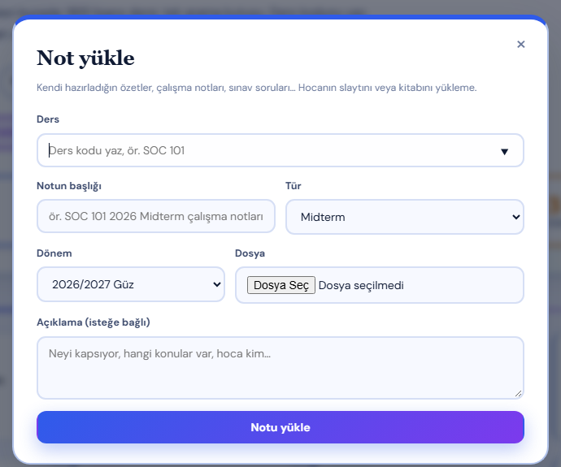

# bunot

**Boğaziçi Üniversitesi öğrencileri için ders notu paylaşım sitesi.**
Bütün dersler tek arama kutusunda; her bölümün gerçek müfredatı dönem dönem;
öğrenciler kendi notlarını yükleyip paylaşıyor.



## Neden yaptım

Boğaziçi'nde notlar WhatsApp gruplarında, klasörlerde, eski öğrencilerin
bilgisayarlarında dağınık duruyor. Hangi dersin notu var, kimde var, hangi döneme
ait — belli değil. bunot bunu tek yerde topluyor: dersi bul, notu olanı gör,
indir. Not yüklemek de 30 saniyelik iş.

## Neler var

- **1472 ders** (869 lisans dersi) tek arama kutusunda. `tr109`, `TR 109`,
  `tr-109` hepsi aynı dersi bulur; Türkçe harflere toleranslı arama.
- **30 lisans programı** için 8 dönemlik resmî müfredat. Dersler sınıf sınıf
  listelenir, "birini seç" seçenekleri ayrı kutu olarak gösterilir.
- **Giriş yılına göre müfredat**: kayıt olurken girdiğin yıl, o yılın programını
  getirir; program değiştiyse uyarı notu düşer.
- **Sadece Boğaziçi e-postası**: `@boun.edu.tr` ve `@std.bogazici.edu.tr`.
- **Not yükleme**: ders, başlık, tür (Midterm, Final, Quiz…), dönem, dosya.
  İndirme sayısı tutulur, kendi notunu silebilirsin.
- **Notu olan dersler öne**: bölüm ve arama listelerinde notu olan ders başta;
  "sadece notu olanlar" süzgeciyle boş dersler gizlenir.
- **İndirmeden bakma**: PDF ve resimler tarayıcıda açılır; beğenirsen indirirsin.
- **Beğeni ve kaydetme**: "işime yaradı" sayacı, sonra bakmak için kaydetme ve
  kendi **Kaydettiklerim** sayfan.
- **Bölümüm**: her dönemin başında o dönemdeki derslerin not sayısı.
- **Şifremi unuttum**: e-posta + kayıtlı ad eşleşirse yeni şifre belirlenir.
- Açık/koyu tema, fareyle açılan bölüm paneli, mobil uyumlu, klavyeyle gezilebilir.

## Ekranlar

**Bölüm sayfası — dönem dönem ders programı**



**Not yükleme**



## Nasıl çalışır

Sunucu yok, veritabanı yok: küçük bir Python sunucusu (`http.server`) hem
sayfaları hem JSON tabanlı API'yi sunuyor. Veriler `site/veri/` altındaki JSON
dosyalarında; yüklenen dosyalar diskte. Ön yüz tek sayfa: hash tabanlı yönlendirme,
framework yok, sıfır bağımlılık.

- Ders kataloğu ve müfredat, Boğaziçi'nin halka açık lisans programları
  sayfalarından bir kez çekilip JSON'a yazıldı (`araclar/dersleri_indir.py`).
- Şifreler düz metin değil: kullanıcıya özel tuz + SHA-256 özeti.
- Oturumlar HttpOnly çerezle tutulur.

## Çalıştırma (Windows)

1. Python 3 kurulu olmalı.
2. `Siteyi aç.vbs` dosyasına çift tıkla. Site `http://localhost:8765` adresinde açılır.

Sunucu yalnızca bu bilgisayarda çalışır; internete açık değildir.

## Teknolojiler

- Python 3 — `http.server`, `json`, `hashlib`, `secrets` (ek paket yok)
- HTML, CSS (değişkenlerle tema), JavaScript (ES6+, framework yok)
- JSON dosyalarıyla kalıcı veri, dosya sistemi ile not arşivi

## Klasörler

```
Siteyi aç.vbs           siteyi sessizce başlatır, tarayıcıyı açar
site/sunucu.py          sunucu: sayfalar + API (kayıt, giriş, not, indirme)
site/sayfalar/          index.html, stil.css, uygulama.js, fontlar
site/veri/dersler.json  ders kataloğu (2026/2027-1)
site/veri/mufredat.json bölüm müfredatları
site/veri/kisiler.json  hesaplar           (repoya dahil değil)
site/veri/notlar.json   paylaşılan notlar  (repoya dahil değil)
site/veri/dosyalar/     yüklenen dosyalar  (repoya dahil değil)
araclar/                katalog çekme betiği
ekranlar/               README görselleri
```

## Gizlilik

Hesaplar, paylaşılan notlar ve yüklenen dosyalar kişisel veri olduğu için
`.gitignore` ile repo dışında tutulur. Depoda yalnızca site kodu ve halka açık
ders/müfredat bilgisi bulunur.

---

## English

**A course-notes sharing site for Boğaziçi University students.** All courses in
one search box, the official curriculum for each of 30 undergraduate programs
semester by semester, and student-uploaded notes with type, term and download
counts. Courses that already have notes are listed first, notes can be previewed
in the browser before downloading, and users can like and bookmark them.
Membership is limited to Boğaziçi e-mail addresses.

Built with a small Python `http.server` backend and a dependency-free vanilla
JS front end. Course catalogue and curricula were scraped once from the
university's public program pages and stored as JSON. Passwords are stored as
salted SHA-256 hashes; sessions use HttpOnly cookies. Personal data (accounts,
uploaded notes) is excluded from the repository.
